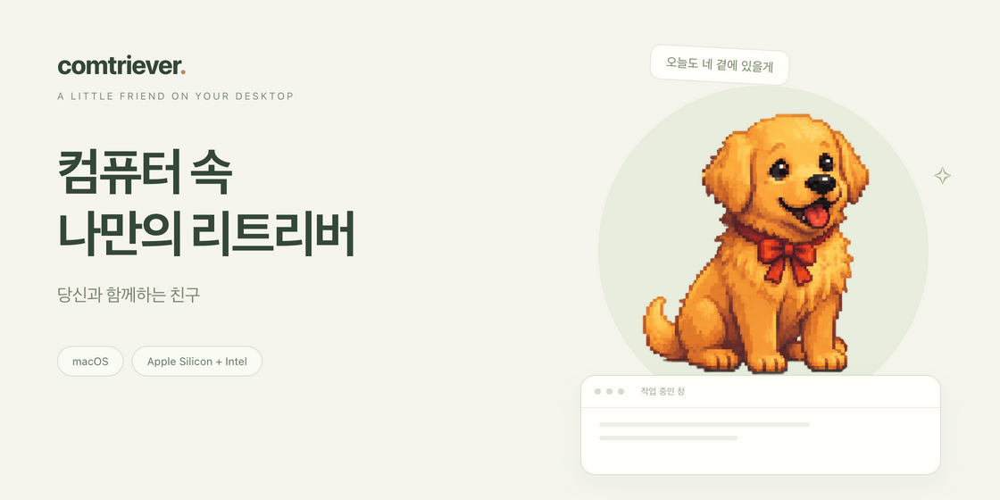
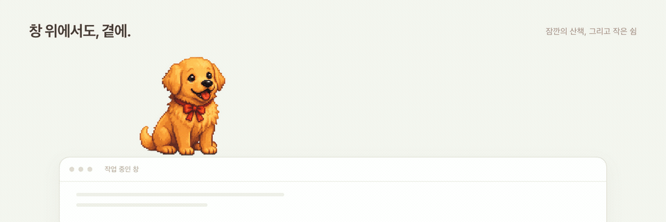
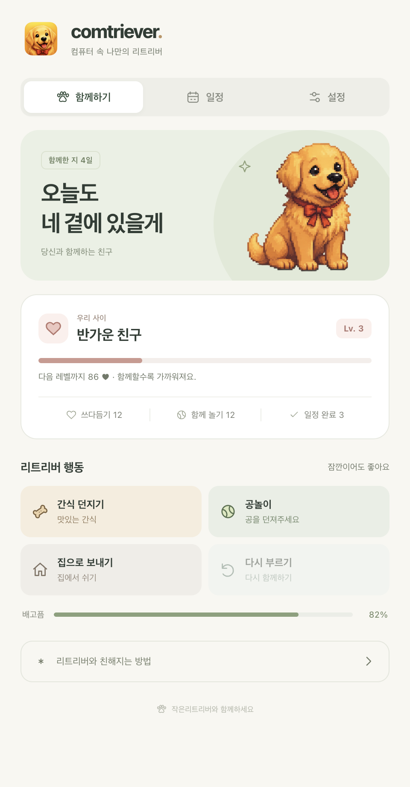

<p align="center">
  
</p>

<p align="center">
  <strong>일하는 화면에, 함께 지내는 작은 친구.</strong><br />
  쓰다듬고, 공을 던지고, 잠깐 자리를 비웠다 돌아오면 반겨주는 macOS 데스크톱 반려견이에요.
</p>

<p align="center">
  <a href="https://github.com/YuSeungjun/Comtriever/releases/latest/download/comtrierver.dmg"><strong>macOS용 다운로드 ↓</strong></a>
  &nbsp; · &nbsp;
  <a href="https://github.com/YuSeungjun/Comtriever/releases">업데이트 소식</a>
  &nbsp; · &nbsp;
  <a href="https://github.com/YuSeungjun/Comtriever/issues">의견 보내기</a>
</p>

<p align="center"><sub>Apple Silicon · Intel Mac 공용 / 무료 공개 테스트</sub></p>

## 화면 속에서 함께 지내요

<p align="center">
  
</p>

<p align="center"><sub>앱에서 사용하는 캐릭터와 애니메이션으로 구성한 소개 장면이에요.</sub></p>

| 함께하는 순간 | 리트리버가 해주는 일 |
| --- | --- |
| **살살 쓰다듬기** | 머리·몸·배를 문질러주면 반응하고, 함께한 시간이 친밀도로 쌓여요. |
| **안아주고 내려놓기** | 꾹 눌러 들어 올리면 감정을 표현해요. 옮겨 놓으면 사뿐히 내려와요. |
| **간식과 공놀이** | 간식을 찾아 먹고, 던진 공을 주워 기다려요. 공을 다시 집어 던지며 계속 놀 수 있어요. |
| **창 위에서 쉬고 걷기** | 열린 창 위에 앉혀두면 창을 따라 움직이고, 가끔 그 위에서 산책해요. |
| **일정 챙기기** | 한 번·매일·매주 알림을 등록하고, 완료하거나 10분 뒤로 미룰 수 있어요. |
| **다시 만나기** | 자리를 비웠다 돌아오면 반겨줘요. 집중이 필요할 때는 집으로 보내 쉬게 해주세요. |

## 함께할수록 가까워져요

<p align="center">
  
</p>

처음에는 **1레벨 ‘첫 만남’**, 함께할수록 **8레벨 ‘평생의 가족’** 단계까지 가까워져요. 친밀도와 설정, 일정은 Mac에 저장되어 다음에 실행해도 이어집니다.

- **내 작업에 맞는 표시 방식** — 항상 위에 두거나, 작업창을 가리지 않게 둘 수 있어요.
- **투명한 여백은 클릭 통과** — 강아지 옆의 폴더와 창도 그대로 클릭할 수 있어요.
- **집에서는 편하게 쉬기** — 집으로 보내놓은 동안에는 배고픔 게이지가 줄어들지 않아요.

## 처음 만나는 방법

1. [최신 `comtrierver.dmg`](https://github.com/YuSeungjun/Comtriever/releases/latest/download/comtrierver.dmg)를 다운로드해요.
2. DMG를 열고 **Comtriever.app → Applications**로 드래그해요.
3. 응용 프로그램 폴더에서 **Comtriever**를 실행하면 준비 끝!

현재는 Apple Developer ID 서명·공증 전의 공개 테스트 버전이에요. 처음 실행할 때 차단된다면 앱을 한 번 실행한 뒤 **시스템 설정 → 개인정보 보호 및 보안 → 그래도 열기**에서 허용할 수 있어요.

<details>
<summary><strong>처음 써본다면, 이것만 기억해 주세요</strong></summary>

- **쓰다듬기:** 누른 직후 머리나 몸을 살살 문질러 주세요.
- **옮기기:** 같은 자리에서 약 **0.4초 꾹 누른 뒤** 움직여 주세요.
- **놀이 메뉴:** 강아지에 마우스를 올리면 나타나요. 우클릭하면 메뉴를 고정할 수 있어요.
- **공 다시 던지기:** 공을 주운 뒤 입 앞의 공을 잡아 다시 던져 주세요. 끝내려면 **그만**을 눌러요.
- **창 위에 앉히기:** 강아지가 들어갈 윗공간이 있는 창의 윗가장자리에 살며시 놓아주세요.
- **설정 열기:** 메뉴 막대의 리트리버 아이콘을 누르고 **설정 열기**를 선택해요.

일정 알림은 앱이 실행 중일 때 확인하며, 놓친 일정은 다음 실행·복귀 때 다시 표시해요. 더 자세한 내용은 [사용 가이드](docs/USAGE.md)를 확인해 주세요.

</details>

## 직접 실행해 보고 싶다면

macOS, Node.js·npm, Xcode Command Line Tools가 필요해요.

```bash
git clone https://github.com/YuSeungjun/Comtriever.git
cd Comtriever
npm ci
npm start
```

실행에 필요한 캐릭터 이미지는 저장소에 포함되어 있어요. 원본 이미지 폴더를 따로 받거나 다시 가공할 필요가 없어요.

[개발·빌드 가이드](docs/DEVELOPMENT.md) · [자세한 사용법](docs/USAGE.md) · [버그 제보와 기능 제안](https://github.com/YuSeungjun/Comtriever/issues)

---

<p align="center">작은 리트리버와 함께하세요 🐾</p>
